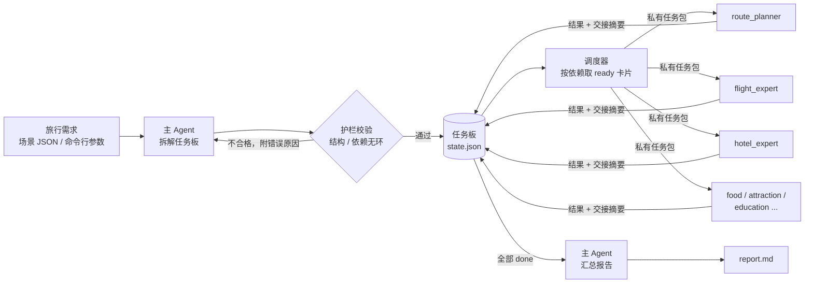
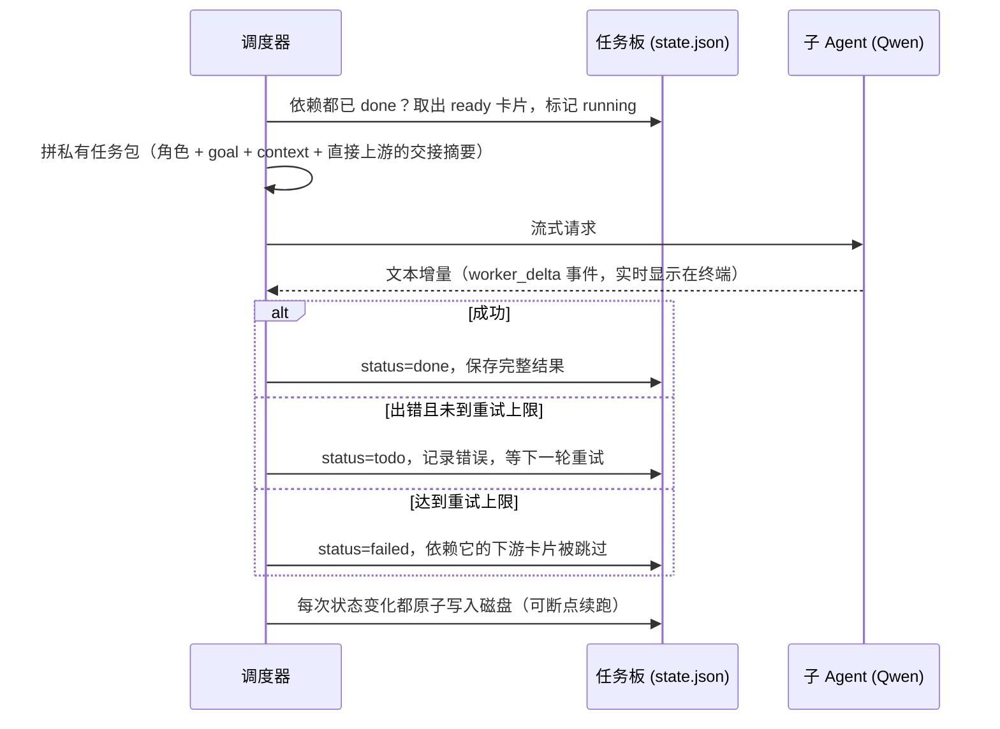

# Travel Assistant：多 Agent 旅行规划命令行工具

一个在终端里运行的多 Agent 旅行规划助手。输入一份旅行需求（目的地、天数、人数、预算、兴趣），**主 Agent** 把需求拆成一张有依赖关系的任务板，交给机票、酒店、美食、景点、教育、预算等**专业子 Agent** 并行完成，最后由主 Agent 汇总成一份逐日行程方案（Markdown）。

> A terminal-based multi-agent travel planner: a planner agent decomposes the request into a dependency-aware task board, specialist worker agents execute it in parallel with isolated context, and the planner synthesizes a day-by-day itinerary.

```text
$ python -m travel_assistant plan --scenario scenarios/usa_30days.json --concurrency 4

主 Agent 正在拆解任务板…
✓ 任务板已生成，共 7 张卡
▶ plan_route route_planner 开始
✓ plan_route 完成（1058 字）
▶ book_flights flight_expert 开始
▶ book_hotels hotel_expert 开始
▶ curate_food food_expert 开始
▶ schedule_attractions attraction_expert 开始
✓ schedule_attractions 完成（998 字）
▶ design_education education_expert 开始
✓ book_hotels 完成（1225 字）
...
✓ 所有子任务完成
主 Agent 正在汇总最终方案…
✓ 最终方案已生成（14638 字）

执行波次: [plan_route]  →  [book_flights | book_hotels | curate_food |
          schedule_attractions | design_education]  →  [review_budget]
```

<!-- RUN_EXAMPLE -->

## 实际运行效果：美国 30 天

下面是用 [`scenarios/usa_30days.json`](scenarios/usa_30days.json)（上海出发，2 大 1 小，7 月，预算 25 万人民币）实际运行一次的结果，**未经人工修改**。完整报告见 [`examples/usa_30days_report.md`](examples/usa_30days_report.md)，共 233 行、11 个章节。

> 这是模型的原始输出，子 Agent 不能联网，其中有事实错误，见[已知问题](#已知问题与后续计划)。放在这里是为了展示系统的输出结构和规划能力，不能当作真实攻略使用。

**行程总览**（节选）

> 本方案为首次赴美家庭定制的深度全景行程，兼顾标志性城市地标、世界级自然遗产、科技历史研学与亲子友好主题乐园，节奏舒缓（全行程仅 **6 次酒店更换**，美西段采用自驾串联国家公园与都市），覆盖用户全部必去清单，并针对 12 岁儿童对科技与历史的兴趣，嵌入 5 大沉浸式研学动线。路线分为三段：**美东文化核心段（10 天）→ 中西部枢纽 + 国家公园环线（8 天）→ 美西自驾 + 主题乐园段（12 天）**，含 3 天弹性缓冲。

| 阶段 | 城市/区域 | 天数 | 主要类型 |
|------|------------|------|-----------|
| **美东段** | 纽约 → 华盛顿DC → 波士顿 → 尼亚加拉瀑布 | 10天 | 城市地标｜名校研学｜博物馆群｜瀑布观景 |
| **中西+自然段** | 芝加哥 → 黄石国家公园 → 大峡谷国家公园 → 拉斯维加斯 | 8天 | 城市建筑｜地热奇观｜地质史诗｜沙漠休整 |
| **美西+乐园段** | 拉斯维加斯 → 洛杉矶 → 旧金山 → 优胜美地 → 洛杉矶 → 奥兰多 | 12天 | 自驾风光｜影视工业｜湾区创新｜冰川峡谷｜航天探索｜魔法世界 |

**每日行程**（30 天全部列出，点击展开）

<details>
<summary>第 1–30 天</summary>

| 天数 | 城市/区域 | 主要安排 | 餐饮建议 | 住宿区域 |
|------|------------|-----------|------------|-------------|
| **第1天** | 纽约（NYC） | 抵达JFK机场；接机送至中城酒店；休整+自由漫步时代广场夜景 | Katz’s Delicatessen（熏牛肉三明治） | 纽约中城（The New Yorker等） |
| **第2天** | 纽约（NYC） | 上午：自由女神像（登冠需预约）+埃利斯岛；下午：中央公园泛舟+草莓园；晚间：百老汇《狮子王》学生票 | Smorgasburg布鲁克林市集（周末） | 纽约中城 |
| **第3天** | 纽约（NYC） | 全天：大都会艺术博物馆（时段票强制，含埃及馆+盔甲厅亲子导览）；傍晚：第五大道橱窗巡礼 | Le Bernardin（可选主厨台体验，需预约） | 纽约中城 |
| **第4天** | 纽约（NYC） | 上午：华尔街+纽约证券交易所外景+三一教堂；下午：9·11纪念馆+One World Observatory；晚间：乘地铁至布鲁克林大桥步行观夜景 | The Apple Pan（返程前汉堡晚餐） | 纽约中城 |
| **第5天** | 华盛顿DC | 早班机抵DCA；入住市中心酒店；下午：国家广场漫步（华盛顿纪念碑+林肯纪念堂+越战墙）；晚间：史密森尼航空航天馆夜场（限流开放） | Mitsitam Café（史密森尼原住民风味餐厅） | 华盛顿市中心（Hilton Garden Inn等） |
| **第6天** | 华盛顿DC | 全天：史密森尼三馆联动研学——航空航天馆（AR登月舱）+自然历史馆（恐龙拓印）+美国历史馆（1776信件解密） | Union Market美食区（多元轻食） | 华盛顿市中心 |
| **第7天** | 华盛顿DC | 上午：国会大厦参观（需预约）+最高法院外景；下午：弗里尔与赛克勒美术馆（亚洲艺术+儿童工坊）；晚间：乔治城海港游船（灯光夜航） | Filomena Ristorante（意式家庭餐厅） | 华盛顿市中心 |
| **第8天** | 波士顿（BOS） | 早班机抵BOS；入住南站旁酒店；下午：哈佛大学校园导览（Science & Society AR路线）+哈佛广场咖啡休憩；晚间：查尔斯河夜景 | Neptune Oyster（龙虾卷） | 波士顿南站/北区（Hyatt Regency等） |
| **第9天** | 波士顿（BOS） | 上午：MIT Stata Center机器人互动+校园打卡；下午：自由之路徒步（保罗·里维尔故居+老州议会大厦+波士顿倾茶事件博物馆）；晚间：海港游船 | Union Oyster House（炸软壳蟹） | 波士顿南站/北区 |
| **第10天** | 尼亚加拉瀑布（NIAGARA） | 上午：乘美铁/包车赴尼亚加拉（约6h）；下午：雾中少女号气泡船（瀑布核心区）+彩虹桥美加边境合影；当晚飞芝加哥 | 观瀑餐厅Murray’s（瀑布景观位） | 尼亚加拉瀑布城（就近酒店） |
| **第11天** | 芝加哥（CHI） | 抵达ORD；千禧公园（云门+皇冠喷泉）+建筑游船（含密歇根大道讲解）；晚间：Giordano’s深盘披萨 | Giordano’s（深盘披萨+意式香肠卷） | 芝加哥卢普区（近千禧公园） |
| **第12天** | 黄石国家公园（YELLOWSTONE） | 飞抵Jackson Hole（JAC）；接机入园；下午：老忠实间歇泉（观测时段需查）+大棱镜温泉（空中步道）；观星导览（夏季可见银河） | Old Faithful Snow Lodge餐厅（园内） | 黄石园内（Old Faithful Snow Lodge） |
| **第13天** | 黄石国家公园（YELLOWSTONE） | 上午：黄石湖+海登谷野生动物观察（野牛/麋鹿）；下午：猛犸热泉+上瀑布观景点；晚间：自然课堂（地质小实验） | Lodge餐厅（提供儿童餐） | 黄石园内（Old Faithful Snow Lodge） |
| **第14天** | 大峡谷国家公园（GRAND CANYON） | 飞盐湖城（SLC）转车至大峡谷南缘（约5h）；入住El Tovar；傍晚：赫尔维斯角日落观景+地质导览 | El Tovar餐厅（峡谷景观位） | 大峡谷南缘（El Tovar Hotel） |
| **第15天** | 大峡谷国家公园（GRAND CANYON） | 全天：Rim Trail徒步（轻松段）+Yavapai观景点地质课堂+星空导览（夏季银河清晰）；可选直升机短途（需单独预约） | Bright Angel Lodge餐厅（自助餐） | 大峡谷南缘（El Tovar Hotel） |
| **第16天** | 拉斯维加斯（LV） | 驱车返拉斯（约4.5h）；休整；傍晚：威尼斯人运河+百乐宫喷泉；夜间：Fremont Street光影秀 | Carnival Court美食广场（平价多元） | 拉斯维加斯大道（MGM Grand等） |
| **第17天** | 洛杉矶（LA） | 自驾赴LA（约4.2h）；下午：加州科学中心（奋进号航天飞机+IMAX《太空漫游》+火箭推进力测试台）；晚间：L.A. Live夜景 | Guerreros Tacos（塔三拼） | 洛杉矶机场区（Hilton LAX等） |
| **第18天** | 洛杉矶（LA） | 全天：环球影城（Studio Tour优先通道+儿童适配项目＞80%）；可选VIP导览 | Universal CityWalk餐饮（含儿童菜单） | 洛杉矶机场区 |
| **第19天** | 旧金山（SF） | 自驾赴SF（约6h，含金门大桥停靠）；下午：金门大桥Battery Spencer观景点+Crissy Field家庭休息亭；傍晚：渔人码头Boudin Bakery酸面包浓汤 | Boudin Bakery（酸面包碗蛤蜊浓汤） | 旧金山渔人码头（Hotel Zephyr等） |
| **第20天** | 旧金山（SF） | 上午：探索馆（Hands-on科学互动）；下午：斯坦福大学校园导览（主广场+胡佛塔+工程学院外景）；晚间：联合广场购物 | Zuni Café（农场直供烤鸡） | 旧金山渔人码头 |
| **第21天** | 优胜美地国家公园（YOSEMITE） | 自驾赴优胜美地（约2.5h）；下午：隧道观景点+Mirror Lake步道（平缓环线）；观星入门课 | Ahwiyah Point Lodge餐厅 | 优胜美地山谷（Ahwiyah Point Lodge） |
| **第22天** | 优胜美地国家公园（YOSEMITE） | 全天：冰川点观景（需预约接驳）+酋长岩远眺+自然课堂（冰川地貌手作）；可选马背骑行（需提前预约） | Lodge餐厅（提供打包午餐） | 优胜美地山谷（Ahwiyah Point Lodge） |
| **第23天** | 洛杉矶（LA） | 自驾返LA（约4h）；下午：盖蒂中心（免费停车+轮椅/婴儿车全租+花园迷宫）；晚间：格里菲斯天文台（好莱坞标志+日落观景） | The Apple Pan（怀旧汉堡） | 洛杉矶机场区 |
| **第24天** | 洛杉矶（LA） | 全天：迪士尼乐园（MagicBand+Genie+预约制，12岁适用全部项目）；重点：明日世界+探险世界+幻想世界 | Blue Bayou Restaurant（幽灵公馆内） | 洛杉矶机场区 |
| **第25天** | 奥兰多（ORL） | 飞抵MCO；接机入住迪士尼合作酒店；下午：迪士尼之泉（免费娱乐+购物）；晚间：酒店泳池放松 | Disney’s Art of Animation Resort餐厅 | 奥兰多迪士尼区 |
| **第26天** | 奥兰多（ORL） | 全天：肯尼迪航天中心“Next Gen Explorer”家庭导览（模拟发射控制台+宇航服试穿）；含IMAX太空影片 | 4 Rivers Smokehouse（南方烧烤） | 奥兰多迪士尼区 |
| **第27天** | 奥兰多（ORL） | 全天：奥兰多环球影城（哈利波特园区+变形金刚3D+侏罗纪公园）；推荐Express Pass | Universal’s Cabana Bay Beach Resort餐厅 | 奥兰多迪士尼区 |
| **第28天** | 奥兰多（ORL） | 上午：迪士尼好莱坞影城（玩具总动员+星球大战园区）；下午：自由活动/补漏；晚间：迪士尼烟火秀 | Hollywood & Vine（角色早餐） | 奥兰多迪士尼区 |
| **第29天** | 奥兰多（ORL） | 缓冲日：可选补游、购物或休整；推荐：奥兰多科学中心（儿童友好互动展）或迪士尼水乐园（需确认开放） | 4 Rivers Smokehouse（儿童餐含迷你肋排） | 奥兰多迪士尼区 |
| **第30天** | 奥兰多（ORL） | 上午：酒店退房；前往MCO机场；搭乘国际航班返程（建议选晚班机，预留充足时间） | 机场内Taste of Orlando美食廊 | — |

</details>

**预算估算**（由 `budget_reviewer` 汇总，主 Agent 整理）

| 类别 | 参考区间（人民币） |
|---|---|
| 国际机票（含 10 段美国内陆航段） | ¥24,000–32,000 |
| 酒店 | ¥68,000–85,000 |
| 餐饮 | ¥22,000–28,000 |
| 门票 + 研学 | ¥9,500–12,000 |
| 租车 + 油费 + 儿童座椅 | ¥18,000–23,000 |
| 签证（B2）+ 旅行保险 + 小费 | ¥7,400–8,700 |
| 应急备用金（10%） | ¥15,000–18,000 |
| **总计** | **¥183,000–225,000（≤ 25 万元）** |

报告其余章节：机票与城际交通、住宿建议、美食清单、玩乐与门票、教育与研学、预订时间线与清单、风险与待核实事项。

这次运行的统计：主 Agent 拆出 7 张卡，分 3 个波次执行，第 2 波 5 张卡同时运行；共产生 1225 个流式片段；`check` 验收通过。

## 为什么要用多 Agent

让一个模型在一次长对话里完成 30 天的行程规划，常见三个问题：

1. **上下文污染**：机票、酒店、美食的细节都堆在同一个对话里，互相干扰，后面的内容质量下降。
2. **状态丢失**：哪些部分做完了、哪些还没做，只存在于对话记忆里。
3. **过早宣布完成**：模型说“已完成”，但有些方面其实没有覆盖到。

本项目的做法是：

- **主 Agent** 只负责拆任务、调度和最终汇总，掌握全局。
- **子 Agent** 每次只拿到自己那张卡的最小必要信息，完成一个局部任务。
- **任务板**是结构化状态，保存在磁盘上，不依赖任何一方的对话记忆。
- 只有任务板上所有卡片都是 `done`，才会进入汇总阶段。

## 功能

- **动态拆解**：任务数量、内容、分配给哪个子 Agent、依赖关系都由主 Agent 决定，代码不预设固定流程。
- **按依赖并行执行**：没有依赖关系的任务同时运行，并发数可配置。
- **上下文隔离**：子 Agent 看不到用户的完整需求和其他任务，下游只拿到直接上游的“交接摘要”。
- **输出护栏**：校验任务板的结构、数量、命名、执行者和依赖（必须无环）；不合格时把错误原因反馈给主 Agent 重新生成。
- **失败处理**：单张卡失败会自动重试；最终失败时只跳过依赖它的下游任务，其余任务照常完成。
- **断点续跑**：每一步都保存状态；中断或失败后用 `resume` 接着跑，已完成的任务不会重做。
- **流式进度**：终端实时显示各子 Agent 的进度，`-v` 可以看到子 Agent 逐字输出。
- **需求可复用**：需求写在 JSON 场景文件里，也可以完全用命令行参数指定；子 Agent 的角色同样可以在场景文件里自定义。
- **自动验收**：`check` 命令检查任务是否全部完成、报告章节是否齐全、每日行程是否覆盖到最后一天。

## 架构



一次运行分三个阶段：

1. **建板**：主 Agent 读取完整需求，输出 JSON 任务板；代码校验通过后保存。
2. **调度**：调度器反复找出“依赖已全部完成”的卡片，用信号量控制并发，把每张卡裁剪成私有任务包交给对应的子 Agent，结果写回任务板。
3. **汇总**：主 Agent 读取所有卡片的结果，生成包含每日行程、机票、住宿、美食、玩乐、教育、预算、预订时间线和风险的完整方案。

### 上下文隔离是怎么做的

每张卡交给子 Agent 时，只包含：

| 内容 | 来源 |
|---|---|
| 角色职责 | 场景文件里该子 Agent 的描述 |
| 任务目标和背景 | 主 Agent 为这张卡写的 `goal` 和 `context` |
| 上游交接摘要 | **只取 `depends_on` 里直接上游**结果中的 `## 交接摘要` 小节 |

子 Agent 看不到用户的原始需求、其他卡片、主 Agent 的对话。这一点由数据结构保证，并有单元测试覆盖（见 `tests/test_orchestrator.py`）。

### 任务状态

```text
todo → running → done
          ↓
        todo（等待重试）→ running → failed → 下游卡片标记为跳过
```

## 每个 Agent 怎么工作

系统里有两类 Agent，都是同一个模型（默认 `qwen-plus`），区别只在于**系统提示词、能看到的信息、输出格式**。下面用美国 30 天那次真实运行说明。

### 主 Agent：建板和汇总

主 Agent 在一次运行中被调用两次，是唯一能看到用户完整需求的角色。

**第一次：建板。** 输入是完整需求（`TripRequest.brief()`）加上可用子 Agent 的名单和职责，要求只输出 JSON。它要自己决定拆成几张卡、每张卡交给谁、`goal` 和 `context` 怎么写、依赖关系怎么设计。提示词里有一条关键约束：

> 子 Agent 看不到用户原始需求，`context` 里必须写清它需要的天数、人数、预算、偏好等要点。

也就是说，主 Agent 要负责"翻译"：把完整需求裁剪成每张卡各自需要的那一部分。返回的 JSON 经过 `validate_board()` 校验；不通过时，错误原因会附在下一次提示词末尾，最多重试 3 次。

**第二次：汇总。** 所有卡片完成后，主 Agent 读取完整需求和每张卡的结果（每张最多 1800 字），按固定章节生成最终方案，并要求不得出现"已确认""已预订"之类的字样。

### 子 Agent：各做一张卡

每个子 Agent 每次调用都是**一次全新的、无状态的请求**，拿到的只有：

```text
你的角色: hotel_expert —— 住宿：各城市推荐区域、酒店档次与价位、订房策略
任务: 匹配各城市住宿方案
目标: 为路线中每一停留城市/区域推荐 2–3 家酒店：标注位置、房型、参考价位、儿童友好设施……
背景: 2 成人 + 1 名 12 岁孩子；30 天行程，同一城市最多连住 3 晚；美西自驾段需酒店支持免费停车……
上游任务的交接摘要:
[plan_route]
（route_planner 输出中「## 交接摘要」那一小节，最多 600 字）
```

输出必须是三个固定小节：`## 结论`、`## 风险与待核实`、`## 交接摘要`。其中**交接摘要是写给下游看的**：下游卡片只会拿到这一节，拿不到上游的全文。

以下是这次运行中 7 张卡的实际分工（目标为主 Agent 原话的节选）：

| 波次 | 任务卡 | 子 Agent | 主 Agent 给它的目标（节选） | 依赖 |
|---|---|---|---|---|
| 1 | `plan_route` | route_planner | 输出城市顺序、各段停留天数（含缓冲日）、每日活动类型；每城换住 ≤2 次，美西安排自驾段 | 无 |
| 2 | `book_flights` | flight_expert | 上海往返美国的航班建议；分段城际交通；租车要求、自驾路段里程和时长 | plan_route |
| 2 | `book_hotels` | hotel_expert | 每个停留城市推荐 2–3 家酒店，含家庭房、儿童设施、预订策略；国家公园需园内或门口选项 | plan_route |
| 2 | `curate_food` | food_expert | 每城 3–5 家代表餐厅，标注必点菜、人均价、儿童友好度、预约建议 | plan_route |
| 2 | `schedule_attractions` | attraction_expert | 按必去清单列景点，标注 7 月开放时间、门票、预约强制性、排队预测、快速通道策略 | plan_route |
| 2 | `design_education` | education_expert | 为哈佛、MIT、斯坦福、史密森尼、肯尼迪航天中心等设计 1.5 小时亲子导览动线 | plan_route |
| 3 | `review_budget` | budget_reviewer | 汇总机票、酒店、餐饮、门票、租车、签证、保险、10% 备用金，核验是否 ≤25 万元 | 第 2 波全部 5 张 |

几个子 Agent 的真实输出片段：

> **route_planner**：美东段（10 天）：纽约（4 天｜地标+名校研学+百老汇）→ 华盛顿 DC（3 天）→ 波士顿（2 天）→ 尼亚加拉（1 天，当晚飞芝加哥）……7 月美东湿热（26–33℃），建议晨昏活动；黄石/大峡谷/优胜美地需提前预约入园。

> **education_expert**：华盛顿段聚焦三馆联动——航空航天馆（AR 登月舱体验 +"设计你的火星车"磁贴工坊）、自然历史馆（恐龙化石拓印 +"琥珀寻虫"显微镜挑战）、美国历史馆（"1776 年信件解密"触屏游戏）。

> **budget_reviewer**：国际机票 ¥24,000–32,000；酒店 ¥68,000–85,000；餐饮 ¥22,000–28,000……应急备用金 ¥15,000–18,000。**汇总区间：¥183,000–225,000，≤25 万元达标。**

`budget_reviewer` 能做出这个汇总，是因为它的任务包里带着第 2 波 5 个子 Agent 的交接摘要。但它**拿不到** `plan_route` 的输出：`plan_route` 不是它的直接上游，路线信息只能通过中间那 5 张卡的摘要间接传过来。单元测试专门验证了这一点。

### 一张卡的完整生命周期



调度器不调用模型。"下一步做哪张卡"完全由任务板状态决定：哪些卡的依赖都已完成，就同时派发，最多并发 `--concurrency` 个。

### 和 ACP 的关系

[ACP（Agent Client Protocol）](https://agentclientprotocol.com/) 是一个让程序通过 stdin/stdout 上的 JSON-RPC 驱动外部编码 Agent（如 Codex）的协议，流程是 `initialize → session/new → session/prompt`，子 Agent 通过 `session/update` 流式回传内容，需要读写文件或执行命令时通过 `session/request_permission` 向调用方申请授权。

**本项目没有使用 ACP**，子 Agent 是直接调用 OpenAI 兼容接口的模型请求。原因是旅行规划只需要文字输出，不需要子 Agent 读写文件或执行命令，直接调用更轻、更快，也更容易测试。

不过模型调用被抽象成了 `LLM` 协议（`complete()` + `aclose()`），调度器只依赖这个协议。如果以后希望子 Agent 是一个能使用工具的完整 Agent（比如能联网查航班的 Codex），可以实现一个基于 ACP 的 `LLM`：每次 `complete()` 新建一个 ACP 会话，把私有任务包作为 prompt 发出，把 `agent_message_chunk` 更新转成 `on_delta` 回调，并在 `request_permission` 里按白名单决定允许还是拒绝。调度、任务板、隔离、重试这些逻辑都不用改。

## 快速开始

需要 Python 3.10+，以及阿里云百炼（DashScope）的 API Key。模型调用走 OpenAI 兼容接口，换成其他兼容服务只需改环境变量。

```powershell
pip install -r requirements.txt

# Windows PowerShell
$env:DASHSCOPE_API_KEY = "sk-..."
# macOS / Linux
export DASHSCOPE_API_KEY="sk-..."

python -m travel_assistant plan --scenario scenarios/usa_30days.json
```

也可以把变量写进项目根目录的 `.env` 文件，程序启动时会自动读取。

| 环境变量 | 说明 | 默认值 |
|---|---|---|
| `DASHSCOPE_API_KEY` | 模型服务的 API Key | 必填 |
| `QWEN_DEFAULT_MODEL` | 默认模型 | `qwen-plus` |
| `QWEN_BASE_URL` | OpenAI 兼容接口地址 | `https://dashscope.aliyuncs.com/compatible-mode/v1` |
| `TRAVEL_RUNS_DIR` | 运行记录保存目录 | `.travel_runs` |

## 使用

### 规划一次旅行

```powershell
# 用场景文件
python -m travel_assistant plan --scenario scenarios/usa_30days.json

# 只用命令行参数
python -m travel_assistant plan --destination "日本 东京+京都+大阪" --days 7 `
    --travelers "2 位成人" --budget "3 万人民币" --interests "美食,历史文化"

# 场景文件 + 命令行覆盖部分字段
python -m travel_assistant plan --scenario scenarios/usa_30days.json --days 21 --budget "18 万人民币"

# 先只看任务板，满意再执行
python -m travel_assistant plan --scenario scenarios/usa_30days.json --dry-run
python -m travel_assistant resume
```

### 全部命令

| 命令 | 作用 |
|---|---|
| `plan` | 生成一份新的旅行方案 |
| `resume [run]` | 继续未完成的运行，失败或中断的任务会重跑 |
| `list` | 列出历史运行及任务进度 |
| `show [run]` | 查看任务板和最终方案；`--task <id>` 查看某个子 Agent 的完整输出 |
| `check [run]` | 验收：任务全部完成、报告章节齐全、每日行程覆盖到最后一天 |
| `init <path>` | 生成一个场景 JSON 模板 |

`[run]` 可以是 `latest`（默认）、运行目录名或其前缀。

常用参数：

| 参数 | 说明 |
|---|---|
| `--concurrency N` | 同时运行的子 Agent 数量，默认 3 |
| `--max-attempts N` | 每张卡最多尝试次数，默认 2 |
| `--model` / `--worker-model` | 主 Agent / 子 Agent 分别使用的模型 |
| `-v, --verbose` | 实时打印子 Agent 的输出 |
| `--runs-dir` | 运行记录保存目录 |

退出码：`0` 成功；`1` 运行未完成或验收不通过；`2` 参数或配置错误；`130` 用户中断（进度已保存）。

### 运行产物

每次运行在 `.travel_runs/` 下生成一个目录：

```text
.travel_runs/20261108-154908-美国-30-天东西海岸经典全景游/
├── state.json   # 完整状态：需求、任务板、每张卡的输入与结果、事件流（用于续跑和审计）
└── report.md    # 最终旅行方案
```

## 场景文件

```json
{
  "title": "美国 30 天东西海岸经典全景游",
  "destination": "美国（美东 + 美西 + 中部国家公园）",
  "days": 30,
  "departure_city": "上海",
  "travelers": "2 位成人 + 1 名 12 岁孩子",
  "budget": "总预算约 25 万人民币（含国际机票）",
  "travel_month": "7 月",
  "interests": ["标志性城市地标", "国家公园自然风光", "地道美食", "名校与博物馆研学"],
  "aspects": ["机票", "酒店", "美食", "玩乐", "教育", "城际交通", "预算与签证保险"],
  "must_see": ["纽约 自由女神像", "黄石国家公园", "大峡谷国家公园", "旧金山 金门大桥"],
  "notes": "第一次去美国，不想每天换酒店，美西部分可以自驾。",
  "min_tasks": 6,
  "max_tasks": 12
}
```

完整示例见 [`scenarios/usa_30days.json`](scenarios/usa_30days.json)。列表字段也可以写成逗号分隔的字符串；写错字段名会直接报错，不会被静默忽略。

### 自定义子 Agent

在场景文件里加入 `agents` 字段，就能替换默认的 7 个子 Agent，主 Agent 只会在这些角色之间分配任务：

```json
{
  "agents": {
    "route_planner": "整体路线与每地停留天数",
    "ski_expert": "滑雪场选择、雪票与装备租赁",
    "food_expert": "当地美食与餐厅预约",
    "budget_reviewer": "预算汇总与风险复核"
  }
}
```

默认子 Agent：`route_planner`（路线）、`flight_expert`（机票与城际交通）、`hotel_expert`（住宿）、`food_expert`（美食）、`attraction_expert`（景点与门票）、`education_expert`（名校、博物馆与研学）、`budget_reviewer`（预算、签证保险与风险）。

## 测试

```powershell
python -m pytest tests -q
```

测试使用一个假模型，不联网、不消耗额度，覆盖：

- 任务板校验：非法 id、未知执行者、依赖不存在、自依赖、循环依赖、重复 id、数量越界等；
- 主 Agent 输出不合格时带着错误原因重新生成，超过次数后放弃；
- 无依赖任务并行执行，且不超过并发上限；
- 上下文隔离：下游只拿到直接上游的交接摘要，拿不到全文，也看不到用户原始需求；
- 失败重试、失败后跳过下游但兄弟任务照常完成；
- 断点续跑只重跑未完成的任务、不会重新建板；
- 全部命令行子命令及退出码。

## 项目结构

```text
travel_assistant/
├── cli.py            # 命令行入口与子命令
├── orchestrator.py   # 建板 → 并行调度 → 汇总；重试、续跑、事件流
├── board.py          # 任务卡、任务板、护栏校验、依赖分层
├── prompts.py        # 主 Agent / 子 Agent / 汇总三类提示词，交接摘要提取
├── scenario.py       # 旅行需求定义、场景文件加载与参数覆盖
├── llm.py            # 模型接口（OpenAI 兼容），流式输出，JSON 解析
├── storage.py        # 运行目录、状态原子写入、运行记录查找
└── render.py         # 终端界面（rich）
scenarios/
└── usa_30days.json   # 示例场景：美国 30 天
examples/
└── usa_30days_report.md  # 示例场景的模型原始输出
tests/                # pytest，使用假模型
```

模型调用通过 `LLM` 协议抽象（`complete()` + `aclose()`），调度逻辑不依赖具体厂商，测试中的假模型也是实现这个协议。

## 已知问题与后续计划

- **内容需要人工核实。** 子 Agent 不能联网，价格、营业时间、餐厅位置、车程等信息由模型生成。提示词要求模型标注"需核实"，但不能完全避免错误。`check` 只验证结构完整，不验证事实正确。
- **跨阶段一致性没有校验。** 路线、各专项建议和每日行程由不同的调用生成，汇总时可能前后矛盾。

在 [示例输出](examples/usa_30days_report.md) 里能看到的具体问题：

| 位置 | 问题 |
|---|---|
| 第 4 天 | 在纽约推荐 The Apple Pan，这家店实际在洛杉矶 |
| 第 21–22 天 | "Ahwiyah Point Lodge" 不存在，优胜美地园内应为 The Ahwahnee 等 |
| 第 14 天 | "盐湖城转车至大峡谷南缘约 5 小时"，实际车程远超这个时间 |
| 第 12 天 | 从芝加哥直接飞 Jackson Hole 后"接机入园"住老忠实附近，中间还有较长车程 |
| 行程总览 | 写"自驾起于旧金山"，但每日行程是从拉斯维加斯开到洛杉矶，前后不一致 |
| 多处 | 价格写成"2023 年 7 月参考值"，航班号为模型编造 |

这些问题正好说明：多 Agent 解决的是**分工、隔离和流程可靠性**，解决不了**事实准确性**，后者需要接入真实数据源。

计划中：

- [ ] 为子 Agent 接入搜索 / 地图 / 航班查询工具（可通过 ACP 接入能使用工具的 Agent）
- [ ] 增加"事实核查"子 Agent，对汇总报告做交叉验证
- [ ] 汇总阶段增加一致性检查（城市顺序、天数合计、住宿与行程匹配）
- [ ] 支持导出 HTML / PDF

## 致谢

主从 Agent 协作、公共任务板与私有任务包的设计思路，来自知乎大模型课程中莫欣老师讲授的《实现 Hermes 中的多 Agent 协作、主 Agent 调度》。本项目在此基础上独立实现为一个通用的命令行工具，并增加了并行调度、失败隔离、断点续跑、场景配置和测试。
