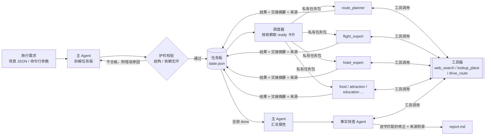
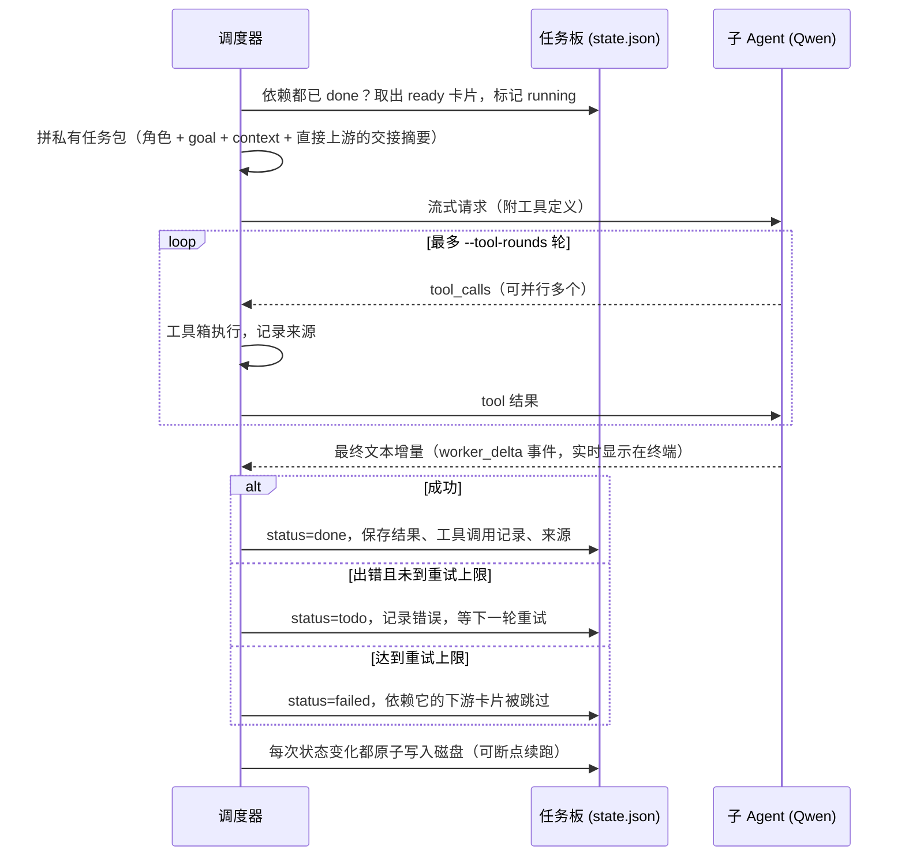

# Travel Assistant：多 Agent 旅行规划命令行工具

一个在终端里运行的多 Agent 旅行规划助手。输入一份旅行需求（目的地、天数、人数、预算、兴趣），**主 Agent** 把需求拆成一张有依赖关系的任务板，交给机票、酒店、美食、景点、教育、预算等**专业子 Agent** 并行完成。子 Agent 可以调用**网页搜索、地点查询、驾车路线**三个工具核实真实数据，最后由主 Agent 汇总成逐日行程，再由**事实核查 Agent** 用工具复核硬事实并自动修正。

> A terminal-based multi-agent travel planner: a planner agent decomposes the request into a dependency-aware task board, tool-using specialist agents execute it in parallel with isolated context and ground their answers in web search, OpenStreetMap and OSRM routing, and a fact-checker agent verifies and patches the final day-by-day itinerary.

```text
$ python -m travel_assistant plan --scenario scenarios/usa_30days.json --concurrency 4

模式: 联网核实（网页搜索 / 地点查询 / 驾车路线）
主 Agent 正在拆解任务板…
✓ 任务板已生成，共 7 张卡
▶ plan_route route_planner 开始
✓ plan_route 完成（810 字，工具 27 次 / 来源 38 条）
▶ book_flights flight_expert 开始
▶ book_hotels hotel_expert 开始
▶ curate_food food_expert 开始
▶ schedule_attractions attraction_expert 开始
✓ book_hotels 完成（946 字，工具 5 次 / 来源 9 条）
▶ design_education education_expert 开始
✓ curate_food 完成（785 字，工具 9 次 / 来源 23 条）
✓ book_flights 完成（1129 字，工具 6 次 / 来源 16 条）
✓ schedule_attractions 完成（902 字，工具 28 次 / 来源 70 条）
✓ design_education 完成（753 字，工具 13 次 / 来源 41 条）
▶ review_budget budget_reviewer 开始
✓ review_budget 完成（1152 字，工具 3 次 / 来源 14 条）
✓ 所有子任务完成
主 Agent 正在汇总最终方案…
事实核查 Agent 正在用工具核查方案中的硬事实…
✓ 事实核查完成：核查 12 条，发现错误 2 条，自动修正 2 处
✓ 最终方案已生成

执行波次: [plan_route]  →  [book_flights | book_hotels | curate_food |
          schedule_attractions | design_education]  →  [review_budget]
```

## 实际运行效果：美国 30 天

下面是用 [`scenarios/usa_30days.json`](scenarios/usa_30days.json)（上海出发，2 大 1 小，7 月，预算 25 万人民币）在**联网核实模式**下实际运行一次的结果，**未经人工修改**。完整报告见 [`examples/usa_30days_report.md`](examples/usa_30days_report.md)，文末附有每个子 Agent 查过的全部来源链接和事实核查记录。

这次运行的统计：主 Agent 拆出 7 张卡，分 3 个波次执行；7 个子 Agent 共调用工具 **91 次**，留下 **211 条来源**；事实核查 Agent 核查 **12 条**硬事实，发现并自动修正 **2 处**错误；`check` 验收通过。

**事实核查 Agent 实际做了什么**

| 核查对象 | 结论 | 工具给出的依据 |
|---|---|---|
| Niagara Falls Marriott Fallsview Hotel & Spa | ✅ 正确 | Marriott官网确认该酒店存在，地址位于尼亚加拉瀑布加拿大侧，提供432间客房及瀑布景观。 |
| The Ahwahnee Dining Room | ✅ 正确 | Yosemite官方旅游网站（travelyosemite.com）和NPS均明确列出'The Ahwahnee Dining Room'为 |
| El Tovar Dining Room（需官网预约） | ✅ 正确 | OpenStreetMap查得El Tovar Dining Room真实存在，地址在大峡谷南缘Grand Canyon Village，坐 |
| 自驾GC→LAS（4.5h，I-40+Warm Springs Rd） | ❌ 错误 | 实际车程约3.2小时（203公里），方案高估39%，超出30%阈值。 |
| 自驾SF→YOSEMITE（299km，4.5h） | ✅ 正确 | drive_route返回结果为299公里、4.5小时，与方案完全一致。 |
| 自驾YOSEMITE→SF（4.5h） | ✅ 正确 | drive_route返回结果为303公里、4.6小时，与方案4.5小时误差仅2.2%，未超30%。 |
| Maid of the Mist游船（需电话确认儿童折扣政策） | ❌ 错误 | 官网明确：5岁及以下免费，6–12岁$19.75，无需电话确认，政策公开透明。 |
| The Plaza Hotel | ✅ 正确 | OpenStreetMap查得The Plaza Hotel真实存在，地址为纽约第五大道768号，坐标精确。 |
| Hotel Washington | ✅ 正确 | OpenStreetMap查得Hotel Washington真实存在，地址为华盛顿西北15街515号，坐标精确。 |
| The Godfrey Hotel Boston | ✅ 正确 | OpenStreetMap查得The Godfrey Hotel Boston真实存在，地址为波士顿华盛顿街505号，坐标精确。 |
| Yosemite Valley Lodge | ✅ 正确 | OpenStreetMap查得Yosemite Valley Lodge真实存在，地址在优胜美地山谷内，坐标精确。 |
| Fog Harbor Fish House | ✅ 正确 | OpenStreetMap查得Fog Harbor Fish House真实存在，地址为旧金山渔人码头Pier 39，坐标精确。 |

自动应用到报告中的修正：

| 原文 | 修正为 |
|---|---|
| 自驾GC→LAS（4.5h，I-40+Warm Springs Rd）[S10] | 自驾GC→LAS（3.2h，I-40+Warm Springs Rd）[S10] |
| 上午：Maid of the Mist游船（需电话确认儿童折扣政策） | 上午：Maid of the Mist游船（儿童5岁及以下免费，6–12岁$19.75） |

**每日行程**（30 天逐日列出，点击展开）

<details>
<summary>第 1–30 天</summary>

| 天数 | 城市 | 主要安排 | 餐饮 | 住宿区域 |
|------|------|-----------|--------|-------------|
| 第1天 | 纽约 | 抵达JFK机场；入住The Plaza Hotel；中央公园野餐+第五大道初体验 | 晚餐：The Plaza Hotel内餐厅（家庭房含早餐） | 中城（The Plaza Hotel） |
| 第2天 | 纽约 | 上午：自由女神像渡轮（Statue City Cruises，含Ellis Island）[S1]；下午：时代广场+百老汇橱窗漫步 | 午餐：Shake Shack（时代广场店）；晚餐：The Plaza Hotel | 中城（The Plaza Hotel） |
| 第3天 | 纽约 | 上午：大都会艺术博物馆「青铜时代密码寻宝」数字手册导览[S3]；下午：中央公园划船+贝塞斯达喷泉 | 午餐：Le Pain Quotidien（中央公园南门）；晚餐：The Plaza Hotel | 中城（The Plaza Hotel） |
| 第4天 | 华盛顿 | 上午：Amtrak高铁NYC→WAS（2.5h航班[S1]或3.5h高铁[S1]）；下午：国家广场漫步（越战纪念碑、林肯纪念堂） | 午餐：Food Court at Smithsonian Castle；晚餐：Hotel Washington内餐厅 | 宾州大道核心区（Hotel Washington） |
| 第5天 | 华盛顿 | 上午：华盛顿纪念碑预约登顶[S2]；下午：史密森尼国家自然历史博物馆「火山岩手摸比对+热成像模拟」[S4] | 午餐：Mitsitam Café（NMNH内）；晚餐：Hotel Washington | 宾州大道核心区（Hotel Washington） |
| 第6天 | 波士顿 | Amtrak高铁WAS→BOS（2h）[S1]；下午：哈佛大学校园导览（官网预约免费）[S1]；昆西市场自由活动 | 午餐：Legal Sea Foods（老港店）[S1]；晚餐：The Godfrey Hotel Boston内餐厅 | 唐人街/昆西市场旁（The Godfrey Hotel Boston） |
| 第7天 | 波士顿 | 上午：MIT Museum「机器人拆解观察卡」[S1]；下午：自由之路步行（保罗·里维尔故居→老州议会大厦） | 午餐：Union Oyster House（美国最古老餐厅）；晚餐：The Godfrey Hotel Boston | 唐人街/昆西市场旁（The Godfrey Hotel Boston） |
| 第8天 | 尼亚加拉瀑布（加拿大安省） | 高铁/租车赴尼亚加拉；入住Niagara Falls Marriott Fallsview Hotel & Spa；马蹄瀑布夜景 | 晚餐：Marriott酒店内餐厅（需确认儿童菜单） | 加拿大侧瀑布观景台步行圈（Niagara Falls Marriott）[S3] |
| 第9天 | 尼亚加拉瀑布（加拿大安省） | 上午：Maid of the Mist游船（儿童5岁及以下免费，6–12岁$19.75）；下午：Skylon Tower观景+彩虹桥美加边境合影 | 午餐：Table Rock Restaurant（瀑布边）；晚餐：Marriott酒店 | 加拿大侧瀑布观景台步行圈（Niagara Falls Marriott）[S3] |
| 第10天 | 芝加哥 | 飞ORD→CHI（短途航班）；下午：千禧公园（Cloud Gate最佳拍摄时段：工作日午后[S3]）；芝加哥科学馆（需72h核验预约入口[S7]） | 午餐：Giordano’s（深盘披萨工坊，提前2天预约[S2]）；晚餐：酒店周边 | 市中心（推荐The Gwen或Hilton Chicago） |
| 第11天 | 黄石国家公园（西黄石） | 飞ORD→WYS（约3.5h含中转）；取车+入园；Old Faithful间歇泉观测+Young Scientist任务卡[S6] | 午餐：Yellowstone General Store（简餐）；晚餐：West Yellowstone镇内餐厅 | 西黄石镇（推荐Explorer Cabins或Holiday Inn West Yellowstone） |
| 第12天 | 黄石国家公园（西黄石） | 上午：Grand Prismatic Spring+Upper Geyser Basin徒步；下午：Hayden Valley野牛观测 | 午餐：Old Faithful Snow Lodge餐厅；晚餐：West Yellowstone镇内 | 西黄石镇（同上） |
| 第13天 | 大峡谷国家公园（南缘） | 飞WYS→PHX→GRAND CANYON（建议联程）；自驾入南缘；Yavapai观景台+日落点[S4] | 午餐：Desert View Watchtower Café；晚餐：El Tovar Dining Room（需官网预约） | 大峡谷南缘（推荐Bright Angel Lodge或Yavapai Lodge） |
| 第14天 | 拉斯维加斯 | 自驾GC→LAS（3.2h，I-40+Warm Springs Rd）[S10]；下午：T-Mobile Arena科技互动展；Fremont Street光影秀 | 午餐：In-N-Out Burger（拉斯维加斯大道店）；晚餐：Las Vegas Strip餐厅 | 拉斯维加斯大道（推荐New York-New York Hotel & Casino） |
| 第15天 | 洛杉矶 | 飞LAS→LAX（1.5h）；下午：好莱坞星光大道+中国剧院手印；晚上：杜比剧院灯光秀 | 午餐：Musso & Frank Grill（好莱坞老店）；晚餐：Hollywood & Highland中心餐厅 | 好莱坞区（推荐Hollywood Roosevelt Hotel） |
| 第16天 | 洛杉矶 | 全天：环球影城（单日票$129–$169，儿童同价[S5]）；优先体验Studio Tour与Super Nintendo World | 午餐：Universal CityWalk餐厅；晚餐：Hollywood Roosevelt Hotel | 好莱坞区（同上） |
| 第17天 | 洛杉矶 | 上午：加州科学中心（免费+航天互动展，替代迪士尼STEM[S6]）；下午：盖蒂中心（免费，须官网预约时段[S5]） | 午餐：California Science Center Café；晚餐：Getty Center Restaurant（需预约） | 好莱坞区（同上） |
| 第18天 | 旧金山 | 飞LAX→SFO（1.5h）；下午：金门大桥南向步行（过桥费$10.50 FasTrak[S5]）；渔人码头初探 | 午餐：Boudin Bakery（已核实存在）；晚餐：Fog Harbor Fish House（需预约，7月午市等位20分钟[S5]） | 渔人码头/北滩（推荐Hotel Zephyr或Argonaut Hotel） |
| 第19天 | 旧金山 | 上午：斯坦福大学Visitor Center（周一至五9:00–17:00[S6]）；下午：探索馆（Exploratorium，亲子科技互动） | 午餐：Stanford Campus Café；晚餐：Fog Harbor Fish House（或酒店内） | 渔人码头/北滩（同上） |
| 第20天 | 优胜美地国家公园 | 自驾SFO→YOSEMITE（299km，4.5h，早7点前出发避堵[S10]）；入住Yosemite Valley Lodge；冰川湖（Glacier Point）日落 | 午餐：中途休息站简餐；晚餐：The Ahwahnee Dining Room（Prime Rib buffet，儿童$29.50[S3]） | Yosemite Valley内（Yosemite Valley Lodge）[S3] |
| 第21天 | 优胜美地国家公园 | 上午：巨杉林（Mariposa Grove）徒步；下午：Mirror Lake步道+星空讲解（亲子轻体验） | 午餐：Yosemite Valley Lodge Café；晚餐：The Ahwahnee Dining Room | Yosemite Valley内（Yosemite Valley Lodge）[S3] |
| 第22天 | 旧金山 | 自驾YOSEMITE→SFO（4.5h[S10]）；下午：旧金山机场还车；飞SFO→MIA→ORL（总耗时约9h[S4]） | 午餐：Yosemite Valley Lodge；晚餐：迈阿密机场简餐 | 奥兰多迪士尼区（推荐Disney’s Grand Floridian Resort & Spa） |
| 第23天 | 奥兰多 | 全天：迪士尼世界Magic Kingdom（含YES STEM研学项目，需提前预约[S5]） | 午餐：Be Our Guest Restaurant；晚餐：Crystal Palace（角色用餐） | 奥兰多迪士尼区（同上） |
| 第24天 | 奥兰多 | 上午：Epcot（未来世界+科技馆）；下午：迪士尼好莱坞影城（Toy Story Land） | 午餐：Sunset Ranch Market（Hollywood Studios）；晚餐：Hollywood & Vine（角色用餐） | 奥兰多迪士尼区（同上） |
| 第25天 | 奥兰多 | 上午：环球影城奥兰多（Universal Studios Florida）；下午：冒险岛（Islands of Adventure） | 午餐：Leaky Cauldron（哈利波特园区）；晚餐：Universal CityWalk | 奥兰多环球影城区（推荐Loews Portofino Bay Hotel） |
| 第26天 | 奥兰多 | 上午：肯尼迪航天中心一日游（NASA研学延伸）；下午：奥兰多市区休整 | 午餐：Kennedy Space Center Café；晚餐：CityWalk餐厅 | 奥兰多环球影城区（同上） |
| 第27天 | 奥兰多 | 上午：迪士尼动物王国（Kilimanjaro Safaris）；下午：迪士尼水乐园Blizzard Beach（暑期开放） | 午餐：Tusker House（动物王国）；晚餐：Loews酒店内 | 奥兰多迪士尼区（同上） |
| 第28天 | 奥兰多 | 全天：弹性缓冲（雷雨延误补救、购物、补漏景点） | 午餐：Disney Springs餐厅；晚餐：酒店内 | 奥兰多迪士尼区（同上） |
| 第29天 | 奥兰多 | 上午：整理行李；下午：机场值机+EVUS信息复核；晚间：CA984或MU588返程航班（ORL→PEK/JFK→SHA） | 午餐：机场简餐；晚餐：航班餐食 | 奥兰多国际机场附近酒店（如Hyatt Regency Orlando） |
| 第30天 | 上海 | 抵达浦东/首都机场；结束行程 | — | — |

</details>

**预算估算**（由 `budget_reviewer` 汇总，主 Agent 整理）

| 类别 | 金额区间（人民币） | 说明 | 来源 |
|------|---------------------|------|------|
| 国际机票（上海–美东往返） | ¥36,000 | 2大1小，含税，需实时核实 | [budget_reviewer] |
| 酒店（25晚，12城） | ¥75,000 | 含家庭房、连住折扣；优胜美地Yosemite Valley Lodge需4月1日抢订[S10] | [budget_reviewer] |
| 餐饮（¥300/人/天×30天×3人） | ¥27,000 | 含Legal Sea Foods、Giordano’s等已核实餐厅[S1] | [budget_reviewer] |
| 门票+年票 | ¥8,500 | $80 America the Beautiful年票覆盖全部国家公园[S10]；迪士尼STEM项目单约 | [budget_reviewer] |
| 城际交通 | ¥22,000 | Amtrak儿童票API可用、SF–YOSEMITE自驾4.5h[S10]、WYS租车接口就绪 | [budget_reviewer] |
| 签证+EVUS | ¥2,400 | B1/B2面签费¥1,620 + EVUS¥290×3人 | [budget_reviewer] |
| 旅行保险 | ¥3,600 | Travel Guard Family Plan，覆盖新冠医疗+行程取消，保额≥¥50万 | [budget_reviewer] |
| 应急金（10%） | ¥25,000 | 用于奥兰多雷雨延误改签或黄石高温应急降温装备 | [budget_reviewer] |
| **总计** | **¥224,500** | 25万元预算可覆盖，余量¥5,500 | [budget_reviewer] |

报告其余章节：行程总览、机票与城际交通、住宿建议、美食清单、玩乐与门票、教育与研学、预订时间线与清单、风险与待核实事项、数据来源与事实核查。

## 为什么要用多 Agent

让一个模型在一次长对话里完成 30 天的行程规划，常见三个问题：

1. **上下文污染**：机票、酒店、美食的细节都堆在同一个对话里，互相干扰，后面的内容质量下降。
2. **状态丢失**：哪些部分做完了、哪些还没做，只存在于对话记忆里。
3. **过早宣布完成**：模型说“已完成”，但有些方面其实没有覆盖到。

本项目的做法是：

- **主 Agent** 只负责拆任务、调度和最终汇总，掌握全局。
- **子 Agent** 每次只拿到自己那张卡的最小必要信息，完成一个局部任务。
- **任务板**是结构化状态，保存在磁盘上，不依赖任何一方的对话记忆。
- 只有任务板上所有卡片都是 `done`，才会进入汇总阶段。

## 功能

- **动态拆解**：任务数量、内容、分配给哪个子 Agent、依赖关系都由主 Agent 决定，代码不预设固定流程。
- **按依赖并行执行**：没有依赖关系的任务同时运行，并发数可配置。
- **上下文隔离**：子 Agent 看不到用户的完整需求和其他任务，下游只拿到直接上游的“交接摘要”。
- **输出护栏**：校验任务板的结构、数量、命名、执行者和依赖（必须无环）；不合格时把错误原因反馈给主 Agent 重新生成。
- **联网核实**：子 Agent 可调用网页搜索、OpenStreetMap 地点查询、OSRM 驾车路线三个工具，推荐的地点和车程有据可查；每次调用的来源都记录在任务卡上，并附在报告末尾。
- **事实核查 Agent**：汇总后再用工具复核报告里的地点和车程，只自动应用"原文逐字出现且只出现一次"的修正，其余列为"仍需人工确认"。
- **每日行程补全**：主 Agent 偶尔会把几天合并成一行；检测到缺天时只重写「每日行程」章节。
- **失败处理**：单张卡失败会自动重试；最终失败时只跳过依赖它的下游任务，其余任务照常完成。工具调用失败不会让任务失败，错误信息会交还给模型，让它换个关键词或标注待核实。
- **断点续跑**：每一步都保存状态；中断或失败后用 `resume` 接着跑，已完成的任务不会重做。
- **流式进度**：终端实时显示各子 Agent 的进度，`-v` 可以看到子 Agent 逐字输出。
- **需求可复用**：需求写在 JSON 场景文件里，也可以完全用命令行参数指定；子 Agent 的角色同样可以在场景文件里自定义。
- **自动验收**：`check` 命令检查任务是否全部完成、报告章节是否齐全、每日行程是否逐日覆盖，联网模式下还会检查每张卡是否留下来源。
- **可离线运行**：加 `--offline` 不使用任何工具，只凭模型知识生成，适合无网络环境或想快速出草稿时使用。

## 架构



一次运行分四个阶段：

1. **建板**：主 Agent 读取完整需求，输出 JSON 任务板；代码校验通过后保存。
2. **调度**：调度器反复找出"依赖已全部完成"的卡片，用信号量控制并发，把每张卡裁剪成私有任务包交给对应的子 Agent。子 Agent 在一个工具调用循环里多轮、并行地调用工具，然后给出结论；结果、工具调用记录和来源一起写回任务板。
3. **汇总**：主 Agent 读取所有卡片的结果，生成完整方案。联网模式下要求只使用子 Agent 查到的名称、采用标注了来源的车程数字。缺天时自动补全「每日行程」。
4. **核查**：事实核查 Agent 挑出最可能出错的硬事实（地点是否存在、是否在对应城市、车程是否偏差超过 30%），用工具逐条核查，返回修正；代码只应用在报告中逐字出现且只出现一次的修正，并把来源和核查记录附在报告末尾。

### 工具

| 工具 | 数据源 | 用途 | 需要 API Key |
|---|---|---|---|
| `web_search` | [ddgs](https://pypi.org/project/ddgs/)（聚合 Google / Yahoo 结果，自动过滤广告链接） | 核实营业信息、门票、预约规则、官网 | 否 |
| `lookup_place` | [OpenStreetMap Nominatim](https://nominatim.org/) | 确认餐厅/酒店/景点存在，返回规范名称和地址 | 否 |
| `drive_route` | [OSRM](https://project-osrm.org/) 公共路由 | 两地驾车距离和纯驾驶时间 | 否 |

工具都封装在 `ToolBox` 里：同一次运行内相同参数只请求一次；Nominatim 按其使用政策串行限速（每秒 ≤1 次）；工具出错时返回错误说明而不是抛异常。后端通过 `ToolBackend` 协议注入，测试里用的是不联网的假后端。

> 之所以没用模型服务商自带的联网搜索，是因为实测 DashScope 的 `enable_search` 对美国地点检索质量很差（搜 "The Apple Pan" 返回的是国内苹果专卖店），而且在 OpenAI 兼容接口下不返回来源，无法审计。

### 上下文隔离是怎么做的

每张卡交给子 Agent 时，只包含：

| 内容 | 来源 |
|---|---|
| 角色职责 | 场景文件里该子 Agent 的描述 |
| 任务目标和背景 | 主 Agent 为这张卡写的 `goal` 和 `context` |
| 上游交接摘要 | **只取 `depends_on` 里直接上游**结果中的 `## 交接摘要` 小节 |

子 Agent 看不到用户的原始需求、其他卡片、主 Agent 的对话。这一点由数据结构保证，并有单元测试覆盖（见 `tests/test_orchestrator.py`）。

### 任务状态

```text
todo → running → done
          ↓
        todo（等待重试）→ running → failed → 下游卡片标记为跳过
```

## 每个 Agent 怎么工作

系统里有三类 Agent，都是同一个模型（默认 `qwen-plus`），区别只在于**系统提示词、能看到的信息、能用的工具、输出格式**。下面用美国 30 天那次真实运行说明。

### 主 Agent：建板和汇总

主 Agent 在一次运行中被调用两次（缺天时再加一次补全），是唯一能看到用户完整需求的角色。它不调用工具。

**第一次：建板。** 输入是完整需求（`TripRequest.brief()`）加上可用子 Agent 的名单和职责，要求只输出 JSON。它要自己决定拆成几张卡、每张卡交给谁、`goal` 和 `context` 怎么写、依赖关系怎么设计。提示词里有一条关键约束：

> 子 Agent 看不到用户原始需求，`context` 里必须写清它需要的天数、人数、预算、偏好等要点。

也就是说，主 Agent 要负责"翻译"：把完整需求裁剪成每张卡各自需要的那一部分。返回的 JSON 经过 `validate_board()` 校验；不通过时，错误原因会附在下一次提示词末尾，最多重试 3 次。

**第二次：汇总。** 所有卡片完成后，主 Agent 读取完整需求和每张卡的结果（每张最多 1800 字），按固定章节生成最终方案。联网模式下额外要求：只用子 Agent 成果里出现过的地点名称；车程采用标注了来源的数字；路线总览、每日行程、交通章节的城市顺序必须一致；每日行程必须逐日一行。

### 子 Agent：各做一张卡，边查边写

每个子 Agent 每次调用都是**一次全新的会话**，拿到的只有：

```text
你的角色: hotel_expert —— 住宿：各城市推荐区域、酒店档次与价位、订房策略
任务: 匹配各城市住宿方案
目标: 为路线中每个住宿城市推荐 2–3 家酒店，注明连住天数、家庭房/加床选项、步行至核心景点距离……
背景: 2 成人 + 1 名 12 岁孩子；30 天行程……
上游任务的交接摘要:
[plan_route]
（route_planner 输出中「## 交接摘要」那一小节，最多 600 字）
```

联网模式下，系统提示词要求它：推荐具体地点前先用 `lookup_place` 或 `web_search` 确认存在、确实在那个城市，查不到的不推荐；写到车程时用 `drive_route` 取真实时长；核实过的信息标注来源，没核实的标注"需核实"。第一轮强制调用工具（`tool_choice="required"`），防止模型跳过核实直接凭记忆作答。

```text
子 Agent 的工具调用循环（最多 --tool-rounds 轮，默认 4）

模型 ──► 一次返回多个 tool_calls（并行）
           lookup_place("The Plaza Hotel, New York")
           lookup_place("Hotel Washington, Washington DC")
           drive_route("San Francisco, CA" → "Yosemite Valley, CA")
工具箱 ─► 并发执行，结果作为 tool 消息交还模型
模型 ──► 根据结果继续查，或输出最终答案
```

输出必须是三个固定小节：`## 结论`、`## 风险与待核实`、`## 交接摘要`。其中**交接摘要是写给下游看的**：下游卡片只会拿到这一节，拿不到上游的全文。

以下是这次运行中 7 张卡的实际分工和工具使用情况：

| 任务卡 | 子 Agent | 工具调用 | 来源 | 用到的工具 |
|---|---|---|---|---|
| `plan_route` | route_planner | 27 | 38 | drive_route、lookup_place、web_search |
| `book_flights` | flight_expert | 6 | 16 | drive_route、lookup_place、web_search |
| `book_hotels` | hotel_expert | 5 | 9 | drive_route、lookup_place、web_search |
| `curate_food` | food_expert | 9 | 23 | drive_route、lookup_place、web_search |
| `schedule_attractions` | attraction_expert | 28 | 70 | drive_route、lookup_place、web_search |
| `design_education` | education_expert | 13 | 41 | drive_route、lookup_place、web_search |
| `review_budget` | budget_reviewer | 3 | 14 | web_search |

`budget_reviewer` 的任务包里带着第 2 波 5 个子 Agent 的交接摘要，但它**拿不到** `plan_route` 的输出：`plan_route` 不是它的直接上游，路线信息只能通过中间那 5 张卡的摘要间接传过来。单元测试专门验证了这一点。

### 事实核查 Agent：复核最终报告

汇总完成后，事实核查 Agent 拿到整份报告草稿和同一套工具，挑出最多 12 条最可能出错的硬事实，优先核查：地点是否真实存在、是否在报告所写的城市；车程与 OSRM 结果相差是否超过 30%。它输出结构化 JSON：

```json
{
  "checked": [{"claim": "自驾GC→LAS（4.5h…）", "verdict": "wrong", "evidence": "实际车程约3.2小时（203公里）"}],
  "corrections": [{"find": "自驾GC→LAS（4.5h，I-40+Warm Springs Rd）[S10]",
                   "replace": "自驾GC→LAS（3.2h，I-40+Warm Springs Rd）[S10]",
                   "reason": "drive_route 实测 3.2 小时"}]
}
```

修正不是让模型重写报告，而是由代码做**精确字符串替换**，并且只接受 `find` 在报告中**逐字出现且恰好出现一次**的修正：同一个片段出现多次时无法确定改哪一处，整体替换可能把正确的地方改错。没被应用的修正和判为错误或未核实的条目，都会列在报告末尾的「仍需人工确认」里，不会被静默丢弃。

开发过程中这条规则是踩坑后加上的：第一版允许替换所有出现，结果核查 Agent 想把"拉斯维加斯 → 大峡谷 4h45m"改成 3h15m 时，把另外两段同样写着"4h45m"的路线也一起改了。

### 一张卡的完整生命周期



调度器不调用模型。"下一步做哪张卡"完全由任务板状态决定：哪些卡的依赖都已完成，就同时派发，最多并发 `--concurrency` 个。

### 和 ACP 的关系

[ACP（Agent Client Protocol）](https://agentclientprotocol.com/) 是一个让程序通过 stdin/stdout 上的 JSON-RPC 驱动外部编码 Agent（如 Codex）的协议，流程是 `initialize → session/new → session/prompt`，子 Agent 通过 `session/update` 流式回传内容，需要读写文件或执行命令时通过 `session/request_permission` 向调用方申请授权。

**本项目没有使用 ACP**，子 Agent 是直接调用 OpenAI 兼容接口、通过 function calling 使用工具的模型请求。原因是旅行规划只需要"查资料 + 写文字"，不需要子 Agent 读写文件或执行命令，自己实现一个只有三个只读工具的工具循环更轻、更可控，也更容易测试。

模型调用被抽象成了 `LLM` 协议（`complete()`、`run_agent()`、`aclose()`），调度器只依赖这个协议。如果以后希望子 Agent 是一个更完整的外部 Agent（比如 Codex），可以实现一个基于 ACP 的 `LLM`：每次 `run_agent()` 新建一个 ACP 会话，把私有任务包作为 prompt 发出，把 `agent_message_chunk` 更新转成 `on_delta` 回调，`tool_call` 更新转成 `on_tool` 回调，并在 `request_permission` 里按白名单决定允许还是拒绝。调度、任务板、隔离、重试、事实核查这些逻辑都不用改。

## 快速开始

需要 Python 3.10+，以及阿里云百炼（DashScope）的 API Key。模型调用走 OpenAI 兼容接口，换成其他兼容服务只需改环境变量。联网工具使用的都是免费公开服务，不需要额外的 Key。

```powershell
pip install -r requirements.txt

# Windows PowerShell
$env:DASHSCOPE_API_KEY = "sk-..."
# macOS / Linux
export DASHSCOPE_API_KEY="sk-..."

python -m travel_assistant plan --scenario scenarios/usa_30days.json
```

也可以把变量写进项目根目录的 `.env` 文件，程序启动时会自动读取。

| 环境变量 | 说明 | 默认值 |
|---|---|---|
| `DASHSCOPE_API_KEY` | 模型服务的 API Key | 必填 |
| `QWEN_DEFAULT_MODEL` | 默认模型 | `qwen-plus` |
| `QWEN_BASE_URL` | OpenAI 兼容接口地址 | `https://dashscope.aliyuncs.com/compatible-mode/v1` |
| `TRAVEL_RUNS_DIR` | 运行记录保存目录 | `.travel_runs` |

## 使用

### 规划一次旅行

```powershell
# 用场景文件
python -m travel_assistant plan --scenario scenarios/usa_30days.json

# 只用命令行参数
python -m travel_assistant plan --destination "日本 东京+京都+大阪" --days 7 `
    --travelers "2 位成人" --budget "3 万人民币" --interests "美食,历史文化"

# 场景文件 + 命令行覆盖部分字段
python -m travel_assistant plan --scenario scenarios/usa_30days.json --days 21 --budget "18 万人民币"

# 先只看任务板，满意再执行
python -m travel_assistant plan --scenario scenarios/usa_30days.json --dry-run
python -m travel_assistant resume

# 不联网（只凭模型知识，速度快）
python -m travel_assistant plan --scenario scenarios/usa_30days.json --offline

# 查看某个子 Agent 调用了哪些工具、引用了哪些来源
python -m travel_assistant show --task book_hotels
```

### 全部命令

| 命令 | 作用 |
|---|---|
| `plan` | 生成一份新的旅行方案 |
| `resume [run]` | 继续未完成的运行，失败或中断的任务会重跑 |
| `list` | 列出历史运行及任务进度 |
| `show [run]` | 查看任务板和最终方案；`--task <id>` 查看某个子 Agent 的完整输出、工具调用和来源 |
| `check [run]` | 验收：任务全部完成、报告章节齐全、每日行程逐日覆盖；联网模式下还检查来源和事实核查 |
| `init <path>` | 生成一个场景 JSON 模板 |

`[run]` 可以是 `latest`（默认）、运行目录名或其前缀。

常用参数：

| 参数 | 说明 |
|---|---|
| `--concurrency N` | 同时运行的子 Agent 数量，默认 3 |
| `--max-attempts N` | 每张卡最多尝试次数，默认 2 |
| `--model` / `--worker-model` | 主 Agent / 子 Agent 分别使用的模型 |
| `--offline` | 不使用联网工具 |
| `--tool-rounds N` | 每个子 Agent 最多调用工具的轮数，默认 4 |
| `--no-fact-check` | 跳过汇总后的事实核查 |
| `-v, --verbose` | 实时打印子 Agent 的输出和每次工具调用 |
| `--runs-dir` | 运行记录保存目录 |

退出码：`0` 成功；`1` 运行未完成或验收不通过；`2` 参数或配置错误；`130` 用户中断（进度已保存）。

### 运行产物

每次运行在 `.travel_runs/` 下生成一个目录：

```text
.travel_runs/20261108-154908-美国-30-天东西海岸经典全景游/
├── state.json   # 完整状态：需求、任务板、每张卡的输入/结果/工具调用/来源、汇总草稿、事实核查记录、事件流
└── report.md    # 最终旅行方案（末尾附数据来源与事实核查）
```

## 场景文件

```json
{
  "title": "美国 30 天东西海岸经典全景游",
  "destination": "美国（美东 + 美西 + 中部国家公园）",
  "days": 30,
  "departure_city": "上海",
  "travelers": "2 位成人 + 1 名 12 岁孩子",
  "budget": "总预算约 25 万人民币（含国际机票）",
  "travel_month": "7 月",
  "interests": ["标志性城市地标", "国家公园自然风光", "地道美食", "名校与博物馆研学"],
  "aspects": ["机票", "酒店", "美食", "玩乐", "教育", "城际交通", "预算与签证保险"],
  "must_see": ["纽约 自由女神像", "黄石国家公园", "大峡谷国家公园", "旧金山 金门大桥"],
  "notes": "第一次去美国，不想每天换酒店，美西部分可以自驾。",
  "min_tasks": 6,
  "max_tasks": 12
}
```

完整示例见 [`scenarios/usa_30days.json`](scenarios/usa_30days.json)。列表字段也可以写成逗号分隔的字符串；写错字段名会直接报错，不会被静默忽略。

### 自定义子 Agent

在场景文件里加入 `agents` 字段，就能替换默认的 7 个子 Agent，主 Agent 只会在这些角色之间分配任务：

```json
{
  "agents": {
    "route_planner": "整体路线与每地停留天数",
    "ski_expert": "滑雪场选择、雪票与装备租赁",
    "food_expert": "当地美食与餐厅预约",
    "budget_reviewer": "预算汇总与风险复核"
  }
}
```

默认子 Agent：`route_planner`（路线）、`flight_expert`（机票与城际交通）、`hotel_expert`（住宿）、`food_expert`（美食）、`attraction_expert`（景点与门票）、`education_expert`（名校、博物馆与研学）、`budget_reviewer`（预算、签证保险与风险）。

## 测试

```powershell
python -m pytest tests -q
```

测试使用假模型和假工具后端，不联网、不消耗额度，共 42 个，覆盖：

- 任务板校验：非法 id、未知执行者、依赖不存在、自依赖、循环依赖、重复 id、数量越界等；
- 主 Agent 输出不合格时带着错误原因重新生成，超过次数后放弃；
- 无依赖任务并行执行，且不超过并发上限；
- 上下文隔离：下游只拿到直接上游的交接摘要，拿不到全文，也看不到用户原始需求；
- 失败重试、失败后跳过下游但兄弟任务照常完成；
- 断点续跑只重跑未完成的任务、不会重新建板；
- 工具箱：地点查询、路线、搜索、缓存命中，以及各种出错情况都返回给模型而不抛异常；
- 事实核查：只应用逐字且唯一匹配的修正，跳过的修正出现在"仍需人工确认"里；核查失败时保留草稿；
- 每日行程缺天检测与补全，补全失败时保留原稿；
- 离线模式不创建工具、使用不带工具的提示词；
- 全部命令行子命令、参数及退出码。

## 项目结构

```text
travel_assistant/
├── cli.py            # 命令行入口与子命令
├── orchestrator.py   # 建板 → 并行调度 → 汇总 → 补全 → 事实核查；重试、续跑、事件流
├── board.py          # 任务卡、任务板、护栏校验、依赖分层
├── prompts.py        # 各类 Agent 的提示词、交接摘要提取、修正应用、来源附录
├── tools.py          # 工具定义与工具箱：web_search / lookup_place / drive_route
├── scenario.py       # 旅行需求定义、场景文件加载与参数覆盖
├── llm.py            # 模型接口（OpenAI 兼容），流式输出，工具调用循环，JSON 解析
├── storage.py        # 运行目录、状态原子写入、运行记录查找
└── render.py         # 终端界面（rich）
scenarios/
└── usa_30days.json   # 示例场景：美国 30 天
examples/
└── usa_30days_report.md  # 示例场景的模型原始输出（联网核实模式）
tests/                # pytest，使用假模型和假工具后端
```

模型调用通过 `LLM` 协议抽象（`complete()`、`run_agent()`、`aclose()`），工具后端通过 `ToolBackend` 协议抽象，调度逻辑不依赖具体厂商，测试中的假模型和假后端也是实现这两个协议。

## 已知问题与后续计划

联网核实能有效避免"编造地点"和"车程离谱"这两类错误，但不能消除所有问题。在[示例输出](examples/usa_30days_report.md)里仍能看到：

| 位置 | 问题 | 原因 |
|---|---|---|
| 第 4 天 | 写成"Amtrak 高铁 NYC→WAS（2.5h 航班或 3.5h 高铁）"，交通方式表述混乱 | 事实核查每次只挑最多 12 条硬事实，这次没有选中这一条；混乱表述来自 `plan_route` 子 Agent 的原文 |
| 每日行程末尾的说明 | 写着"GC→LAS（4.5h）"，而表格里已被修正为 3.2h | 主 Agent 在说明里复述了旧数字；核查 Agent 只修了表格里那一处 |
| 第 22 天 | 当天从优胜美地开车 4.5 小时回旧金山后，再转机飞奥兰多（总耗时约 9 小时），对孩子强度过大 | 节奏是否合理属于判断问题，工具查不出来 |
| 第 29–30 天 | 返程写成"CA984 或 MU588（ORL→PEK/JFK→SHA）"，航班号与航线对不上 | 没有航班查询工具，航班号仍由模型生成 |
| 多处 | 价格、营业时间来自搜索摘要或模型知识 | 搜索结果只提供摘要，没有读取网页正文 |

能做什么、不能做什么：

- **能**：确认地点真实存在、在哪个城市；给出可复现的驾车距离和时间；为结论附上可点击的来源；在汇总后自动修正一部分可精确定位的错误。
- **不能**：保证价格和营业时间是最新的；查询真实航班；判断行程节奏是否合理；保证报告里同一个事实的所有复述都被同步修正。
- `check` 验证的是结构完整性和"是否留下了来源"，不等于内容全部正确。真实出行前，预订类信息仍需到官网确认。

计划中：

- [ ] 接入航班查询（如 Amadeus 自助 API），替代模型生成的航班号
- [ ] `web_search` 之后抓取网页正文，而不是只看搜索摘要
- [ ] 汇总阶段增加结构化一致性检查（城市顺序、天数合计、同一路段车程在全文中一致、住宿与行程匹配）
- [ ] 节奏检查：单日驾车加飞行时长超过阈值时提示
- [ ] 支持导出 HTML / PDF
